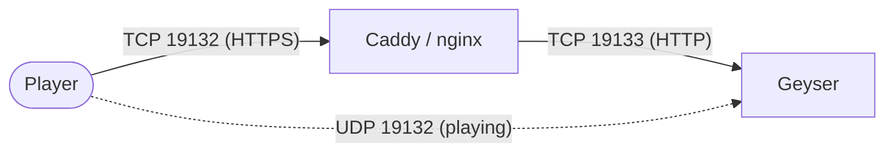

import Tabs from '@theme/Tabs';
import TabItem from '@theme/TabItem';

# HTTPS for NetherNet

Geyser's built-in signaling server uses plain HTTP by default. Over plain HTTP, Minecraft cannot verify which server it is talking to,
so it prompts each Bedrock player on the first join whether they want to trust the server the first time they join ("trust on first use").
Over HTTPS, the server's certificate proves its identity, so Minecraft does not show this prompt.

This page is for people who **host Geyser themselves**. When using a hosting provider, ask your host instead for how you could use HTTPS.
To learn what signaling is, read [Preparing your Geyser server for NetherNet](/blog/preparing-for-nethernet).

:::info Only for built-in signaling
This page only matters if Geyser is configured to use **built-in signaling**: `mode` in the `signaling` section is `builtin` (the default) or `hybrid`.
:::

## What you need {#what-you-need}

1. **A domain name** that points to your server, like `play.example.com`.
   Players must connect with this name, not with an IP address, because the certificate is made for the name.
   If you do not have a domain, you could use a DDNS provider such as [DuckDNS](https://www.duckdns.org) to obtain a free one, like `myserver.duckdns.org`.
2. **A working NetherNet setup** without HTTPS. Make sure players can join first, then add HTTPS.
3. **A certificate for that domain.** If you already have one, you can use it as is.
   Otherwise, you could use [Let's Encrypt](https://letsencrypt.org) to obtain one for free. The steps below do this with Caddy, certbot or win-acme,
   which need TCP port 80 to be reachable from the internet while obtaining and renewing certificates.
   Forward it in your router like your Geyser port. Let's Encrypt's DNS challenge works without port 80, but is not covered here.

## Setting up HTTPS {#setting-up-https}

Geyser can serve HTTPS itself with a certificate set in its config. Alternatively, a reverse proxy such as Caddy or nginx can handle HTTPS in front of Geyser.
If you would rather not manage a certificate at all, [external signaling](/wiki/geyser/geyser-command-line-arguments-and-system-properties#nethernet-system-properties) (`mode: nxs`) is an option as well, if the signaling service provides HTTPS: [Warden](https://warden.cloud) does, but not every service does.

<Tabs groupId="https-method" queryString="method">
<TabItem value="geyser" label="Certificate in the Geyser config" default>

Geyser serves HTTPS on the same port as HTTP, so no extra port is needed. Geyser reads the certificate when it starts, so it needs a restart or run of `geyser reload` after every renewal.

**1. Obtain a certificate**

If you already have a certificate for your domain, skip this step.
Otherwise, you could use [Let's Encrypt](https://letsencrypt.org) to obtain one, for example with certbot or win-acme. These need TCP port 80 to be reachable.

<Tabs groupId="operating-system">
<TabItem value="linux" label="Linux" default>

On Linux, certbot is the recommended way to obtain certificates from Let's Encrypt. Follow the instructions over at [certbot's website](https://certbot.eff.org/instructions) to see how.

</TabItem>
<TabItem value="windows" label="Windows">

Certbot no longer supports Windows, so use [win-acme](https://www.win-acme.com) instead.
In a PowerShell window opened with **Run as administrator**, from the win-acme folder, replacing `C:\path\to\Geyser` with Geyser's config folder:

```powershell
.\wacs.exe --source manual --host play.example.com --validation selfhosting --store pemfiles --pemfilespath C:\path\to\Geyser
```

This creates `play.example.com-chain.pem` and `play.example.com-key.pem` directly in Geyser's config folder, and renews them automatically.

</TabItem>
<TabItem value="macos" label="macOS">

On macOS, certbot is the recommended way to obtain certificates from Let's Encrypt. Follow the instructions over at [certbot's website](https://certbot.eff.org/instructions) to see how.

</TabItem>
</Tabs>

**2. Configure Geyser**

Set the files in the `signaling` section of the Geyser config. With win-acme, use the `-chain.pem` and `-key.pem` files instead.

```yaml
bedrock:
  signaling:
    builtin:
      https:
        certificate: /path/to/fullchain.pem
        private-key: /path/to/privkey.pem
        password: ''
```

- Paths can be relative to Geyser's config folder, or absolute.
- A PKCS12 file (`.p12` or `.pfx`) works as well: put it in `certificate`, leave `private-key` empty, and set its `password`.
  Use `file:/path/to/password.txt` to keep the password out of the config.

:::caution Restart or reload after renewing

After a renewal, restart the server or run `geyser reload`, or players will get an expired certificate.

:::

</TabItem>
<TabItem value="proxy" label="Reverse proxy">

A reverse proxy sits in front of Geyser. It handles HTTPS, and passes signaling on to Geyser.
Gameplay (UDP) still goes straight to Geyser.



**1. Prepare Geyser**

The reverse proxy uses TCP port 19132, so Geyser's signaling has to move to another port, like 19133. Players keep using port 19132.
The ports you forward stay the same: port 19133 is only used on your machine, so do not open it.

Set these values in the `bedrock` section of the Geyser config:

```yaml
bedrock:
  port: 19133
  webrtc-port: 19132
```

`port` is now the port signaling used behind the proxy, and `webrtc-port` keeps gameplay on UDP 19132.

Then tell Geyser to trust the proxy, so it reads each player's real address from the `X-Forwarded-For` header. Add this to the `advanced` section of the config:

```yaml
advanced:
  bedrock:
    signaling-trusted-proxies:
      - 127.0.0.1
```

Leave `address` in the `bedrock` section at `0.0.0.0`. NetherNet does not work if Geyser only listens on `127.0.0.1`.

**2. Set up the proxy**

<Tabs groupId="reverse-proxy">
<TabItem value="caddy" label="Caddy" default>

Caddy can obtain and renew certificates from Let's Encrypt by itself.

**2.1. Install Caddy**

You can install Caddy by following its [installation guide](https://caddyserver.com/docs/install).

**2.2. Write the Caddyfile**

Replace `play.example.com` with your domain:

```caddyfile title="Caddyfile"
{
	servers {
		# Caddy would otherwise use UDP 19132 for HTTP/3, which Geyser needs for playing
		protocols h1 h2
	}
}

play.example.com:19132 {
	reverse_proxy 127.0.0.1:19133
}
```

On its first start, Caddy will attempt to obtain a certificate for your domain, and will renew it automatically when necessary. This requires port 80 to be reachable.
To use an existing certificate instead, add `tls /path/to/fullchain.pem /path/to/privkey.pem` inside the `play.example.com:19132` block.

**2.3. Start Caddy**

<Tabs groupId="operating-system">
<TabItem value="linux" label="Linux" default>

```bash
sudo systemctl enable --now caddy
# after changing the Caddyfile:
sudo systemctl reload caddy
# to see what Caddy is doing:
journalctl -xb -u caddy
```

</TabItem>
<TabItem value="windows" label="Windows">

In a PowerShell window opened with **Run as administrator**, from the folder with `caddy.exe`:

```powershell
.\caddy.exe run
```

To start Caddy automatically with Windows, install it as a service:

```powershell
sc.exe create caddy start= auto binPath= "C:\caddy\caddy.exe run --config C:\caddy\Caddyfile"
sc.exe start caddy
```

</TabItem>
<TabItem value="macos" label="macOS">

```bash
brew services start caddy
# after changing the Caddyfile:
brew services restart caddy
```

</TabItem>
</Tabs>

</TabItem>
<TabItem value="nginx" label="nginx">

nginx does not obtain certificates by itself. If you do not have one yet, you could use certbot or win-acme to obtain one from Let's Encrypt.

**2.1. Install nginx, and obtain a certificate**

<Tabs groupId="operating-system">
<TabItem value="linux" label="Linux" default>

Follow nginx's [installation guide](https://nginx.org/en/docs/install.html), you likely want to install nginx from a package using your distribution's package manager.

If you need a certificate, certbot is the recommended way to obtain certificates from Let's Encrypt on Linux. Follow the instructions over at [certbot's website](https://certbot.eff.org/instructions) to see how. Select "Nginx" as software.

</TabItem>
<TabItem value="windows" label="Windows">

Download nginx from [nginx.org](https://nginx.org/en/download.html) and unzip it to `C:\nginx`.
nginx on Windows is [less polished](https://nginx.org/en/docs/windows.html) than on Linux, but works for this.

If you need a certificate, certbot no longer supports Windows, so use [win-acme](https://www.win-acme.com) instead.
In a PowerShell window opened with **Run as administrator**, from the win-acme folder:

```powershell
.\wacs.exe --source manual --host play.example.com --validation selfhosting --store pemfiles --pemfilespath C:\nginx\certs
```

This creates `play.example.com-chain.pem` and `play.example.com-key.pem` in `C:\nginx\certs`, and renews them automatically.
After a renewal, reload nginx with `C:\nginx\nginx.exe -s reload`.

</TabItem>
<TabItem value="macos" label="macOS">

Install nginx on macOS using the Homebrew package manager:

```bash
brew install nginx
```

If you need a certificate, certbot is the recommended way to obtain certificates from Let's Encrypt on macOS. Follow the instructions over at [certbot's website](https://certbot.eff.org/instructions) to see how. Select "Nginx" as software.
Your nginx config folder can be found by running:

```bash
echo "$(brew --prefix)/etc/nginx/servers/"
```

</TabItem>
</Tabs>

**2.2. Configure nginx**

<Tabs groupId="operating-system">
<TabItem value="linux" label="Linux" default>

Create a file called `geyser.conf` in `/etc/nginx/conf.d/`. If you already have a certificate, point `ssl_certificate` and `ssl_certificate_key` to its files.

```nginx title="geyser.conf"
server {
    listen 19132 ssl;
    server_name play.example.com;

    ssl_certificate     /etc/letsencrypt/live/play.example.com/fullchain.pem;
    ssl_certificate_key /etc/letsencrypt/live/play.example.com/privkey.pem;

    location / {
        proxy_pass http://127.0.0.1:19133;
        proxy_http_version 1.1;
        proxy_set_header Host $host;
        proxy_set_header X-Forwarded-For $proxy_add_x_forwarded_for;
        proxy_set_header X-Forwarded-Proto $scheme;
    }
}
```

</TabItem>
<TabItem value="windows" label="Windows">

Create a file called `geyser.conf` in `C:\nginx\conf\`, then add `include geyser.conf;` inside the `http { }` block of `C:\nginx\conf\nginx.conf`. If you already have a certificate, point `ssl_certificate` and `ssl_certificate_key` to its files.

```nginx title="geyser.conf"
server {
    listen 19132 ssl;
    server_name play.example.com;

    ssl_certificate     C:/nginx/certs/play.example.com-chain.pem;
    ssl_certificate_key C:/nginx/certs/play.example.com-key.pem;

    location / {
        proxy_pass http://127.0.0.1:19133;
        proxy_http_version 1.1;
        proxy_set_header Host $host;
        proxy_set_header X-Forwarded-For $proxy_add_x_forwarded_for;
        proxy_set_header X-Forwarded-Proto $scheme;
    }
}
```

</TabItem>
<TabItem value="macos" label="macOS">

Create a file called `geyser.conf` in `$(brew --prefix)/etc/nginx/servers/`. If you already have a certificate, point `ssl_certificate` and `ssl_certificate_key` to its files.

```nginx title="geyser.conf"
server {
    listen 19132 ssl;
    server_name play.example.com;

    ssl_certificate     /etc/letsencrypt/live/play.example.com/fullchain.pem;
    ssl_certificate_key /etc/letsencrypt/live/play.example.com/privkey.pem;

    location / {
        proxy_pass http://127.0.0.1:19133;
        proxy_http_version 1.1;
        proxy_set_header Host $host;
        proxy_set_header X-Forwarded-For $proxy_add_x_forwarded_for;
        proxy_set_header X-Forwarded-Proto $scheme;
    }
}
```

</TabItem>
</Tabs>

Do not add `quic` or `http3` to the `listen` line: Geyser needs UDP 19132 for playing.

**2.3. Reload nginx**

Use the following commands to reload nginx and activate the new configuration:

<Tabs groupId="operating-system">
<TabItem value="linux" label="Linux" default>

```bash
sudo nginx -t && sudo systemctl reload nginx
```

</TabItem>
<TabItem value="windows" label="Windows">

```powershell
cd C:\nginx
.\nginx.exe -t
.\nginx.exe -s reload
```

</TabItem>
<TabItem value="macos" label="macOS">

```bash
nginx -t && brew services restart nginx
```

</TabItem>
</Tabs>

</TabItem>
</Tabs>

</TabItem>
</Tabs>

## Checking that it works {#checking}

1. Look at the Geyser console. With a certificate in the Geyser config, it says `Built-in signaling started on https:// and http://`.
   When using a reverse proxy, it says `Built-in signaling started on http://` with port 19133.
2. On Bedrock, add the server with your **domain name** and port `19132`. Join it: Minecraft should not ask whether you trust the server.

| What you see | What to do |
|---|---|
| Players still get the trust prompt | Make sure they use the domain name, not the IP address. |
| Console: "Built-in signaling could not start. Make sure no other program is using TCP port …" after adding a certificate | Usually a wrong file path or password. Turn on `debug-mode` in the config and restart to see the real reason. |
| Caddy or certbot cannot get a certificate | Check that TCP port 80 is forwarded to this machine, and that your domain points to your current IP. |
| Server shows up, but joining times out | UDP 19132 is not reachable, or Caddy uses it. Check the `protocols h1 h2` line, and your firewall. |
